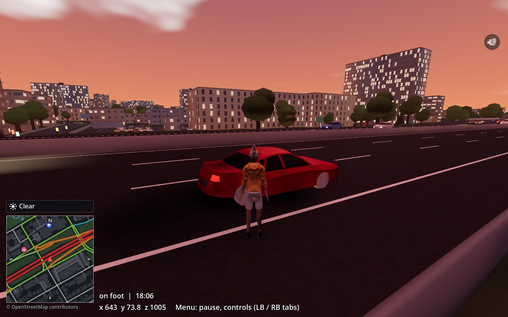

# Code 430

A free, open-source open-world city game in the spirit of GTA III–IV, built on real streets
from OpenStreetMap. The first city is central Ottawa. It's made with Godot by people working
with AI agents, and it's early: expect rough edges.



## Play it
1. **Download** the zip for your system from [Releases](https://github.com/Code430Game/Code430Game/releases):
   - **Windows:** unzip anywhere and run `code430.exe`, keeping the `packs` folder beside it.
     The build isn't code-signed, so SmartScreen warns the first time: More info > Run anyway.
   - **Steam Deck / Linux:** see [Put a build on a Steam Deck](#put-a-build-on-a-steam-deck).
2. **Controls:** an Xbox-style controller or keyboard and mouse. The pause menu's Controls tab
   lists them and rebinds them; the same list is in [`docs/controls.md`](docs/controls.md).
   On a strong PC, set the graphics preset to High in the pause menu's Settings tab.
3. **Found a problem?** Hold Menu (Start) for a second, or press F8, or pick "Report a problem"
   in the pause menu. It saves a screenshot and where you were, and files a GitHub issue; you
   need no account. Reports are **public**: IP and email addresses are removed and the
   reporter id is shown only as a one-way hash, but leave personal details out of what you type.

## What's in it
A playable sandbox in central Ottawa (Centretown), plus Double Cross, a small generated test
district:
- roads, bridges, buildings with houses and yards, water, parking lots and garages, trees;
- traffic, pedestrians and buses, a day-night cycle and weather (rain, snow, fog);
- an on-foot player with a character creator; cars to drive or take (each with a radio), and
  the police helicopter to fly;
- weapons and fists, with a weapon wheel, in three tone modes (clean, gritty, dystopia);
- car damage: dents, smoke, and wrecks that stall, burn or explode by tone;
- police with a wanted level, patrol cars and a helicopter; ambulances; a rival gang's turf;
- a full map with a legend of places and addresses;
- map, story and character packs (the Packs tab), and LAN co-op (in progress);
- the in-game issue reporter.

Not yet: missions, an economy, more cities. [`docs/open-work.md`](docs/open-work.md) lists
what's next, and `openspec/changes/` holds each planned change.

## Help out
- **Code:** read [`CONTRIBUTING.md`](CONTRIBUTING.md) and pick something from
  [`docs/open-work.md`](docs/open-work.md). Bring your agent: `AGENTS.md` has the rules you
  both work to. Pull requests from forks run CI once a maintainer approves them.
- **Cities, stories and ads:** packs live in their own repositories under
  [Code430Packs](https://github.com/Code430Packs); start from
  [PackTemplate](https://github.com/Code430Packs/PackTemplate).
- **Play and report:** reports from the game are the most useful thing a player can send.

[`VISION.md`](VISION.md) has the why.

## Develop
### Requirements
- Godot `4.7.2-stable` (see `.godot-version`). macOS: `brew install --cask godot`. Others: https://godotengine.org/download.
- Python 3.11+ and [uv](https://docs.astral.sh/uv/) for the tools.
- Optional: Node 22 and the OpenSpec CLI (`npm install -g @fission-ai/openspec@$(cat .openspec-version)`) for `openspec validate`.

### Get the packs
The Ottawa map lives in its own repository,
[Code430Packs/Location-OttawaOnCa](https://github.com/Code430Packs/Location-OttawaOnCa). The
game pins the release it uses in `packs.lock.json`; fetch it once after cloning, and again
when the lock changes (CI and packaging do this themselves):
```
scripts/fetch-packs.sh
```

### Open the project
```
godot --path game --editor
```
Or open `game/project.godot` from the Godot project manager. Press F5 to run the play testbed: it loads the Ottawa map pack from `packs/`, builds the city, and puts you on foot beside a car on the Queensway.

For a quick try of a change there is also the Double Cross proving ground, a small generated test district with one of everything and a figure-eight track: `godot --path game -- --pack=code430.proving-ground --drive` starts on its start line (or save the pack under `[map] pack` in `user://settings.cfg`). It is rebuilt from `tools/proving_ground` by `scripts/regen-proving-ground.sh`; CI checks the committed pack matches.

Controls for controller and keyboard are in `docs/controls.md`, generated from the game's input map; the pause menu's Controls tab shows the same list and rebinds them.

Benchmark from the command line (vsync off, prints a frame-time summary and quits):
```
godot --path game -- --benchmark=60 --autodrive --preset=deck --screenshot=/tmp/shot.png   # --drive starts in the car without autodrive
```
More testbed flags: `--traffic=N` caps traffic cars (0 disables), `--spawn=x,z` starts on the nearest road to a local coordinate (`--spawn=x,y,z` puts the player on foot exactly there, such as a garage floor), `--topdown=<height>` looks straight down, `--graph` shows the road graph overlay, `--telemetry` prints the car state every second, `--junction-report` prints junctions whose surface bulges into the grass, leaves part of a road uncovered, falls back to a hull or has terrain above it, with x, z (headless: `godot --headless --path game -s res://world/build/junction_report.gd`).

### Build a map pack
Map packs are built in their own repositories (start one from
[Code430Packs/PackTemplate](https://github.com/Code430Packs/PackTemplate)). From this
checkout, rebuild a district of one of them with its region file:
```
cd tools
uv run python -m osm_import --region <Location repo>/regions/centretown.json \
  --pack-out <Location repo>/packs/centretown --pack-version <next version> --build-stamp
```
That fetches OpenStreetMap roads, water, and buildings plus NRCan elevation data (cached, gitignored; set `CODE430_OSM_CACHE=/path` to keep the cache on a shared volume, or pass `--cache-dir`), and writes the road graph, terrain heightmaps, water and building files, manifest, and validation report. Optionally pre-build the chunk meshes as GLB so the game loads faster:
```
godot --headless --path game -s res://world/build/pack_builder.gd -- code430.ottawa-centretown
```
To play a new release here, tag it in the pack's repository, then update its entry in
`packs.lock.json` (tag, commit, sha256 from the release's `.sha256` file) and run
`scripts/fetch-packs.sh`.

Debug overlay: press F3, or hold Back (View) and press X on a gamepad. It shows fps, frame time, draw calls, and the active preset.

### Run the tests
Godot (gdUnit4, vendored under `game/addons/gdUnit4`):
```
cd game
godot --headless --path . -s -d --remote-debug tcp://127.0.0.1:0 \
  res://addons/gdUnit4/bin/GdUnitCmdTool.gd --ignoreHeadlessMode -c -a res://tests
```
The editor also has a gdUnit4 panel for running tests interactively.

Python tools:
```
cd tools
uv sync
uv run pytest
uv run python -m pack_tools ../packs      # validate pack manifests
```

### Build and package
Install the export templates for the pinned version once (Editor > Manage Export Templates), then:
```
scripts/package.sh linux|windows [--with-chunks] [--zip]
```
It fetches the pinned packs, exports `build/<platform>/` with the packs beside the executable,
and with `--zip` makes `build/code430-<platform>-<commit>.zip` to hand out. The CI workflow can
also export the Linux build when run by hand (Actions > CI > Run workflow); it uploads
`build/linux` as an artifact named `code430-linux-<sha>`.

### Put a build on a Steam Deck
With SSH enabled on the Deck and your key installed, `scripts/package.sh linux && scripts/deploy-deck.sh` exports and syncs the build to `~/Games/code430` on the Deck in one go. A benchmark can then be run remotely while the Deck is in Game Mode:
```
ssh deck@steamdeck.local 'cd ~/Games/code430 && DISPLAY=:0 ./code430.x86_64 -- --benchmark=40 --autodrive --preset=deck'
```
Or let `scripts/deck-bench.sh` do all of it: package, deploy, run the benchmark N times in Game Mode (it outlives the SSH session through `systemd-run`) and print the measured render times, with medians. It can compare two refs (`--ref main --ref change/x`) and note the result under a task (`--change <id> --task 3.1`). `--dry-run` shows what it would do, and `--help` lists the flags. It won't start while the game is running on the Deck.
To get it into the Game Mode library without Desktop Mode, `uv run scripts/deck-add-shortcut.py` writes the non-Steam shortcut over SSH; restart the Deck afterwards and it shows up under the Non-Steam tab.

Manual route:
1. Run `scripts/package.sh linux`, or unzip a Linux release. You get `build/linux/` with `code430.x86_64`, `code430.pck`, and a `packs/` folder. The game looks for packs in the `packs` folder next to the executable, in the user folder's `packs` (Linux `~/.local/share/godot/app_userdata/Code 430/packs`, Windows `%APPDATA%\Godot\app_userdata\Code 430\packs`, macOS `~/Library/Application Support/Godot/app_userdata/Code 430/packs`), or in the repo when run from the editor. Every pack found is listed on the pause menu's Packs tab: A on a data-only pack (characters, stories) enables or disables it for the next load, and A twice on another map pack plays that map (the game restarts on it; it is saved as `[map] pack` in `settings.cfg`). `--packs=id,id` pins the enabled set for one run and `--pack=<id>` the map. The format is documented in `docs/pack-format/README.md`.
2. On the Deck, switch to Desktop Mode (Power menu > Switch to Desktop).
3. Copy both files to the Deck, for example with a USB stick, or from a Mac over the network:
   ```
   scp -r build/linux/ deck@steamdeck.local:~/Games/code430/
   ```
   (Enable SSH on the Deck first: in Konsole, `passwd` then `sudo systemctl enable --now sshd`.)
4. In Konsole on the Deck: `chmod +x ~/Games/code430/code430.x86_64`.
5. In Steam (Desktop Mode): Games > Add a Non-Steam Game to My Library > Browse to `code430.x86_64`. Optional: in its properties, set Launch Options to `--fullscreen`.
6. Switch back to Game Mode and launch it from the Non-Steam tab. The `deck` graphics preset is selected automatically; F3 has no key on the Deck, so use Back + X for the overlay.

#### Windows

`scripts/package.sh windows --zip` exports `build/windows/` (`code430.exe`, `code430.pck`,
`packs/`) and zips it to `build/code430-windows-<commit>.zip`; see [Play it](#play-it) for
running it. `scripts/package-linux.sh` still works as `scripts/package.sh linux`.

### Run the CI checks locally
`scripts/ci-local.sh` runs the same steps as `.github/workflows/ci.yml` on this machine: ruff, pytest, pack validation, `openspec validate --strict --all` (skipped with a note if the OpenSpec CLI isn't installed; the version CI uses is in `.openspec-version`), gdUnit4 (orphan nodes fail the run), and optionally the Linux export (`--export`, needs the export templates installed).

### Repo layout
```
game/                 Godot project (res:// root)
  core/               audio, content modes, input, net (co-op), settings, streaming, debug, report
  world/              packs loader, roads, terrain, buildings, water, barriers, dressing,
                      traffic, pedestrians, vegetation, services, sky; build/ holds the pack builder
  actors/             player, character, vehicles, combat, police, emergency
  ui/                 HUD, maps, pause menu, character creator, report form
  scenes/             the play testbed
  tests/              gdUnit4 tests
tools/                Python tools (uv project): osm_import, pack_tools, report_relay,
                      region_picker, controls_doc.py; tests/ with the golden fixture
packs/                first-party packs (proving ground, characters, example); the Ottawa map
                      is fetched here by scripts/fetch-packs.sh (gitignored)
regions/              region definitions for the importer
scripts/              CI, packaging (Linux, Windows), Steam Deck deploy and shortcut, build stamp
docs/                 controls, backlog, open work, graphics presets, licensing
  pack-format/        pack schemas and docs
  report-format/      issue report format
openspec/             specs and changes
.github/workflows/    CI
```

## Licensing and credits
Three-way split, see `docs/licensing-options.md` for the reasoning:
- Code, schemas, and tools: MIT (`LICENSE`).
- First-party assets: CC BY-SA 4.0 (`LICENSE-ASSETS`).
- Map data derived from OpenStreetMap: ODbL 1.0, credited "© OpenStreetMap contributors"
  (map packs carry their own licence). Elevation from Natural Resources Canada under the Open
  Government Licence – Canada.

Made with [Godot Engine](https://godotengine.org) (MIT; the splash's Godot icon is CC BY 4.0,
Andrea Calabró). Vehicle and character models by [Quaternius](https://quaternius.com), CC0.
Third-party licences are listed in `LICENSE-ASSETS`.
